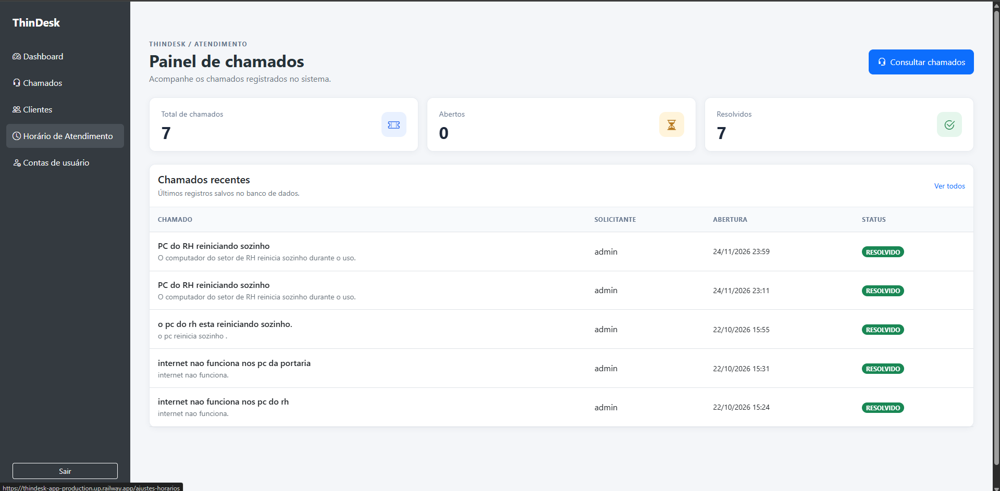

# ThinDesk — Sistema de chamados técnicos

Aplicação web desenvolvida a partir do ThinDesk apresentado na disciplina. O sistema mantém o login e o painel de chamados e permite abrir, acompanhar e resolver solicitações com dados persistidos no MongoDB.

## Versão

**1.1.0**

O projeto segue versionamento semântico no formato `MAJOR.MINOR.PATCH`:

- `MAJOR`: mudança incompatível com versões anteriores.
- `MINOR`: funcionalidade nova compatível.
- `PATCH`: correção compatível.

A versão `1.1.0` está definida no `pom.xml`.

## Funcionalidades

- Login com sessão e controle de acesso por perfil.
- Perfil **USUÁRIO**: abre chamados e acompanha somente os chamados que abriu.
- Perfil **ADMIN**: acessa o dashboard e a fila completa, edita ou cancela chamados abertos, registra soluções, cadastra e desativa contas de usuário, gerencia clientes e configura horários de atendimento.
- Registro automático do solicitante, da data de abertura e do status `ABERTO`.
- Registro da solução, do administrador responsável, da data de resolução e do status `RESOLVIDO`.
- Bloqueio de edição, cancelamento ou nova resolução depois que um chamado for resolvido.
- Validação de campos de chamados, contas, clientes e horários.
- Dashboard com totais e chamados recentes do MongoDB.

## Tecnologias

- Java 21
- Spring Boot 3.4
- Spring MVC, Spring Security e Thymeleaf
- Spring Data MongoDB e MongoDB
- Maven Wrapper
- Postman

## Acesso

- **Aplicação publicada:** [ThinDesk no Railway](https://thindesk-app-production.up.railway.app)


Contas públicas para demonstração:

| Perfil | Usuário | Senha | Permissões principais |
| --- | --- | --- | --- |
| USUÁRIO | `usuario` | `usuario123` | Abrir chamados e acompanhar os próprios chamados. |
| ADMIN | `admin` | `admin123` | Ver o dashboard e todos os chamados; editar, cancelar ou resolver chamados abertos; administrar contas, clientes e horários. |

Essas credenciais são destinadas à avaliação acadêmica. As senhas são armazenadas com hash BCrypt no MongoDB. A aplicação cria as duas contas na primeira inicialização se elas ainda não existirem.

## Execução local

### Requisitos

- JDK 21
- MongoDB em execução
- PowerShell no Windows

O banco padrão chama-se `thindesk`. A aplicação usa `mongodb://localhost:27017/thindesk` quando `MONGODB_URI` não é definida.

### Configuração e inicialização

Na pasta raiz do projeto, configure as variáveis e inicie a aplicação:

```powershell
$env:MONGODB_URI = "mongodb://localhost:27017/thindesk"
$env:THINDESK_USER = "usuario"
$env:THINDESK_PASSWORD = "usuario123"
$env:THINDESK_ADMIN_USER = "admin"
$env:THINDESK_ADMIN_PASSWORD = "admin123"
.\mvnw.cmd spring-boot:run
```

O arquivo `.env.example` registra os mesmos nomes e valores de demonstração, mas o Spring Boot não carrega arquivos `.env` automaticamente. As variáveis devem estar definidas no ambiente antes de iniciar a aplicação.

A aplicação fica disponível em `http://localhost:8080`. Depois de entrar, a página inicial mostra o dashboard.

Para gerar o pacote executável:

```powershell
.\mvnw.cmd -B -DskipTests package
```

## Dashboard

O painel mantém a estrutura visual do ThinDesk e mostra os dados disponíveis no banco.



## Chamados pela aplicação

1. Entre com a conta **USUÁRIO** para abrir chamados e acompanhar somente os que abriu. Após o login, essa conta vai direto à lista de chamados.
2. Em **Chamados**, selecione **Novo chamado**, informe título e descrição e salve. Solicitante, data de abertura e status são preenchidos automaticamente.
3. O perfil **USUÁRIO** consulta os detalhes e o status dos próprios chamados; não edita, cancela ou resolve solicitações.
4. Entre com a conta **ADMIN** para acessar o dashboard e a fila completa. O administrador pode editar ou cancelar chamados abertos e registrar a solução aplicada.
5. Depois da resolução, o chamado exibe o status `RESOLVIDO` e a data correspondente. Chamados resolvidos não podem ser alterados novamente.

O ADMIN também encontra as telas de **Clientes**, **Horário de Atendimento** e **Contas de usuário** no menu lateral. Horários inválidos, com término anterior ou igual ao início, não são salvos.

## API REST de chamados

Os endpoints exigem login. O perfil USUÁRIO abre chamados e consulta somente os próprios. O ADMIN pode consultar qualquer solicitante ou chamado e é o único perfil autorizado a resolver solicitações.

| Método | Endpoint | Permissão e resultado |
| --- | --- | --- |
| `POST` | `/api/chamados` | USUÁRIO abre chamado; retorna `201 Created`. |
| `GET` | `/api/chamados/usuario/{id}` | USUÁRIO consulta a própria lista; ADMIN pode informar qualquer nome de usuário. |
| `GET` | `/api/chamados/{id}` | USUÁRIO consulta o próprio chamado; ADMIN pode consultar qualquer chamado. |
| `PUT` | `/api/chamados/{id}/resolver` | ADMIN registra a solução e conclui um chamado aberto. |

Em `/api/chamados/usuario/{id}`, `{id}` é o nome de usuário. Nos outros endpoints, `{id}` é o identificador MongoDB retornado ao abrir o chamado.

### Abrir chamado

```http
POST /api/chamados
Content-Type: application/json
```

```json
{
  "titulo": "Computador reiniciando",
  "descricao": "O computador do setor de RH reinicia sozinho durante o uso."
}
```

O corpo aceita título e descrição. Solicitante, data de abertura e status inicial `ABERTO` são definidos pelo servidor.

### Resolver chamado

```http
PUT /api/chamados/{id}/resolver
Content-Type: application/json
```

```json
{
  "solucao": "Verificada a memória e substituído o módulo com falha."
}
```

O ADMIN autenticado fica registrado como responsável pela resolução. Uma segunda tentativa para um chamado resolvido retorna `409 Conflict`.

### Respostas de erro

- Dados obrigatórios ausentes ou inválidos: `400 Bad Request`.
- Requisição de API sem login: `401 Unauthorized`.
- Perfil sem permissão: `403 Forbidden`.
- Chamado não encontrado: `404 Not Found`.
- Tentativa de alterar chamado resolvido: `409 Conflict`.

## Postman

A coleção está em `postman/ThinDesk.postman_collection.json`.

1. No Postman, selecione **Import** e abra esse arquivo.
2. A variável `baseUrl` já aponta para a aplicação publicada; para executar localmente, altere-a para `http://localhost:8080`.
3. Execute **Login** com as variáveis `usuario` e `senha` para entrar como USUÁRIO.
4. Execute **Abrir chamado**. A resposta contém o ID e a coleção o salva em `chamadoId`.
5. Use **Listar chamados do usuário** e **Consultar chamado** para acompanhar o registro.
6. Execute **Login do admin** com as variáveis `admin` e `senhaAdmin` e, em seguida, **Resolver chamado**.
7. Execute **Consultar chamado** novamente para ver o status `RESOLVIDO`, a solução e a data de resolução. Uma nova tentativa de resolução retorna `409`.

O Postman mantém a sessão usando o cookie retornado pelo formulário de login.

## MongoDB

A conexão é definida pela variável `MONGODB_URI`. No ambiente local, o padrão é `mongodb://localhost:27017/thindesk`. No MongoDB Compass, conecte-se a `mongodb://localhost:27017` e abra o banco `thindesk`.

As principais coleções são:

- `chamados`: título, descrição, solicitante, status, datas, solução e responsável pela resolução.
- `contasAcesso`: nome de usuário, perfil, situação da conta e hash BCrypt da senha.
- `clientes`: clientes cadastrados pelo ADMIN.
- `horariosAtendimento`: horários de atendimento por setor e dia da semana.

## Publicação no Railway

A aplicação está publicada em [https://thindesk-app-production.up.railway.app](https://thindesk-app-production.up.railway.app) e utiliza o serviço MongoDB do projeto ThinDesk-M2. O `Dockerfile` prepara a aplicação para execução no Railway.

Variáveis usadas pela aplicação:

| Variável | Finalidade |
| --- | --- |
| `MONGODB_URI` | URI de conexão com o MongoDB. No Railway, está ligada ao serviço MongoDB. |
| `THINDESK_USER` | Nome da conta pública de demonstração USUÁRIO. |
| `THINDESK_PASSWORD` | Senha pública de demonstração USUÁRIO. |
| `THINDESK_ADMIN_USER` | Nome da conta pública de demonstração ADMIN. |
| `THINDESK_ADMIN_PASSWORD` | Senha pública de demonstração ADMIN. |
| `PORT` | Porta informada pelo Railway. |
